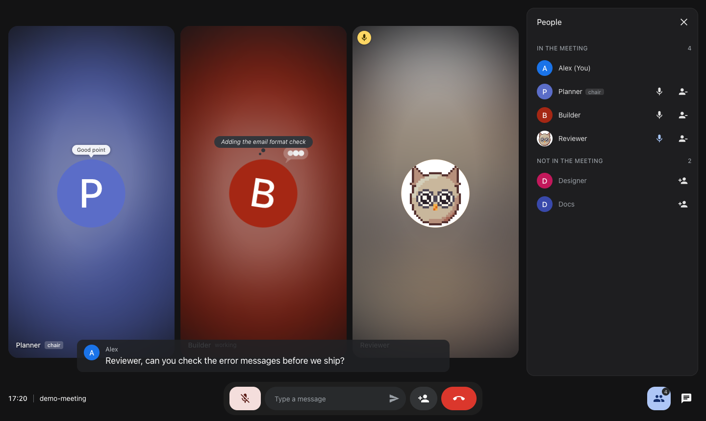
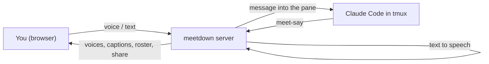

# meetdown

A voice meeting with your Claude Code sessions. You talk in the browser; the sessions running in tmux hear you, answer by voice, show files on a shared screen and pass the turn to each other. The page looks and behaves like Google Meet with the cameras off.



<sub>Made-up names and data. The reviewer uses a custom image (`look.image`).</sub>



## What you get

- Push to talk (hold, or tap to keep talking). Long talks are sent in pieces that grow by 25 s (25 s, 50 s, 75 s, ... up to 200 s) so the others follow along, and a turn ends by itself after 15 s of talk and 5 s of silence.
- The baton: whoever you name answers by voice; the rest listen, or say a short murmur.
- One voice at a time, by rule: nothing plays over you except a murmur of up to 10 characters.
- Captions for everyone, a minutes panel, a People panel (talk to one, remove, invite), and screen sharing with pin and close.
- Letter avatars like Meet's, or an image per participant.
- After a server restart, the last participants come back.

## Requirements

| | Why |
|---|---|
| macOS | `bin/url` copies the page URL with `pbcopy` |
| tmux | participants are Claude Code sessions in tmux panes |
| Claude Code | the participants; the minutes summary uses `claude -p` |
| Node.js 22+ | the server and the tests |
| Python 3 and VOICEVOX | the voices |
| Whisper | speech to text |
| A browser with a microphone | open the page on `localhost` or over https |

Currently the pane delivery, speech to text and text to speech are loaded from Claude Code plugins and skills installed on the machine (`tmux-foxhound`, `question-dashboard`, and a VOICEVOX `tts` skill). Making meetdown self-contained is planned.

## Setup

```bash
git clone https://github.com/kurokawamomo/meetdown.git
cd meetdown
cp config.example.json config.json   # then edit it (see below)
node --test                          # optional: run the tests
bin/start                            # the server; a token is created in .token on the first run
bin/url                              # copies http://127.0.0.1:7790/?t=<token> to the clipboard
```

Open the copied URL. The token is stored as a cookie, so later visits need only the address. To use it from a phone, put the server behind Tailscale serve and run `bin/url https://<your tailnet host>:<port>`.

`config.json`, `.token`, `state/` and `meetings/` stay out of git.

### config.json

| Key | Meaning |
|---|---|
| `owner` | your name, as the participants and captions show it |
| `lang` | `ja` or `en` for the page text; put your own strings in `ui` |
| `autoJoin` | sessions that join every new meeting (the chair) |
| `people.<session>` | per session: `label`, `aliases` (words that call it), `voice` and `style` (VOICEVOX), `chair`, `look.letter`, `look.image` |
| `voicePool` | voices for sessions not listed in `people` |
| `sessionReadings` | how you pronounce tmux session names |
| `interimSeconds` | how long each piece of a long talk is (the last one repeats) |
| `autoEnd` | end a turn after `afterSeconds` of talk and `quietSeconds` of silence |
| `murmurMaxChars` | the longest murmur |
| `thoughtVoice` | `true` reads a few words of each new thought, very quietly |

## Hands-on

1. Start two or three Claude Code sessions in tmux and name them (`/rename`).
2. `bin/start`, then open the page.
3. Press the invite button (or open People) and invite a session. It gets a short notice and reads `prompts/meeting.md`, the guide on how to talk here.
4. Hold the mic button (or Space) and say: "Reviewer, what are you working on?". The named session answers by voice.
5. Ask it to show something. It runs `meet-say --share <file>` and the page switches to the presenting layout. Hover it to pin or close.
6. Press the red button to leave. The meeting closes and everyone gets a summary.

### meet-say (for the sessions)

```
meet-say "what to say"                      speak (needs the baton)
meet-say --murmur "short remark"            murmur, half volume, at most murmurMaxChars
meet-say --pass <name> "why"                speak and hand the baton to <name>
meet-say --share <path-or-url> ["caption"]  share a file (html, pdf, png, jpg, svg) or a URL
meet-say --scroll <0-100> | --unshare       scroll or stop the shared page
meet-say --route <word> <name> [--once]     from now on <word> sends the baton to <name>
meet-say --unroute <word>                   forget a route
meet-say --leave "goodbye"                  say goodbye and leave once it is heard
```

The speaker is identified by `$TMUX_PANE`; panes that are not in the meeting are refused.

## Layout

```
server.mjs        the server: routes and meeting state
lib/              meeting log, roster, baton, delivery, speech, thoughts, summary
page/             the page (plain ES modules, no framework)
prompts/          the meeting guide every participant reads
bin/              start, url, meet-say
tts_worker.py     the VOICEVOX worker
```

## License

MIT
